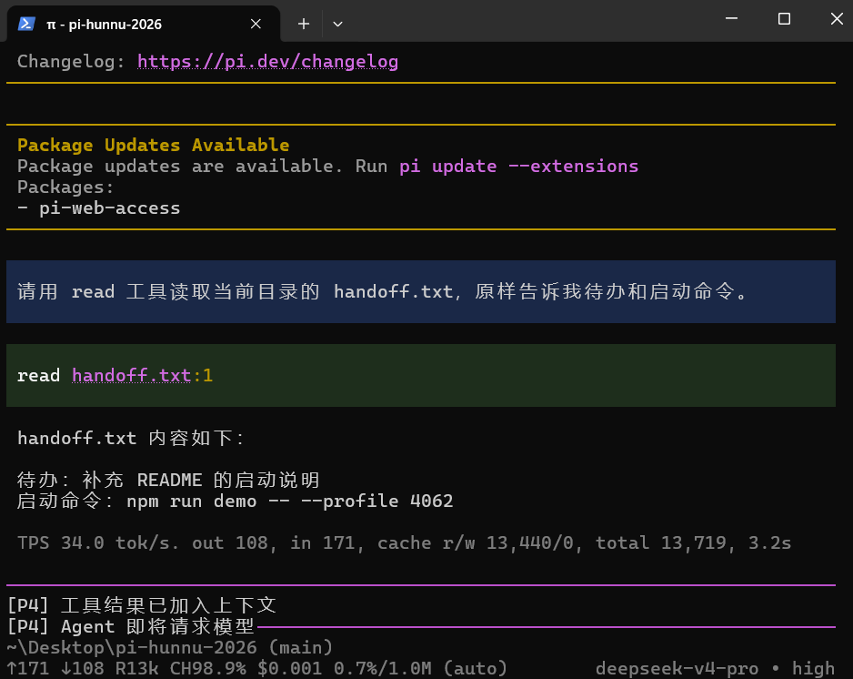
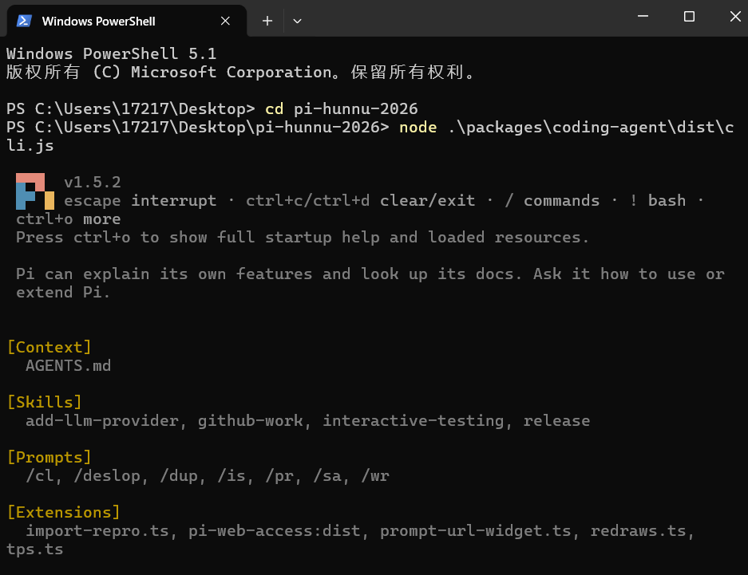
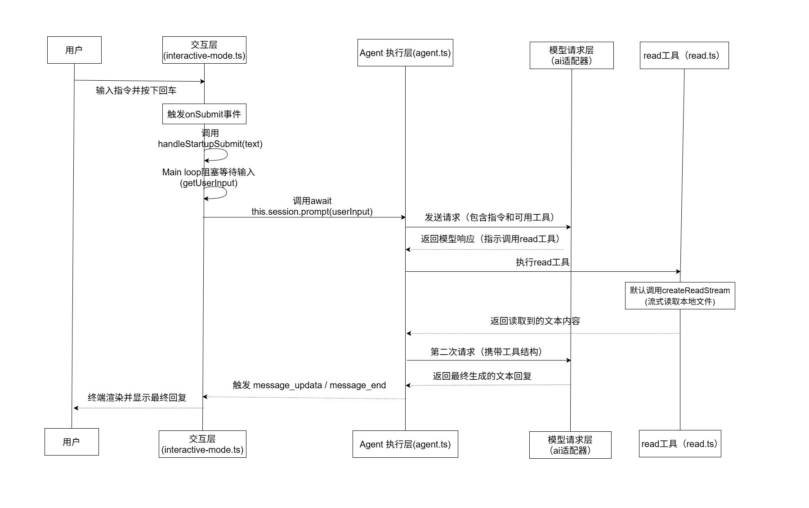
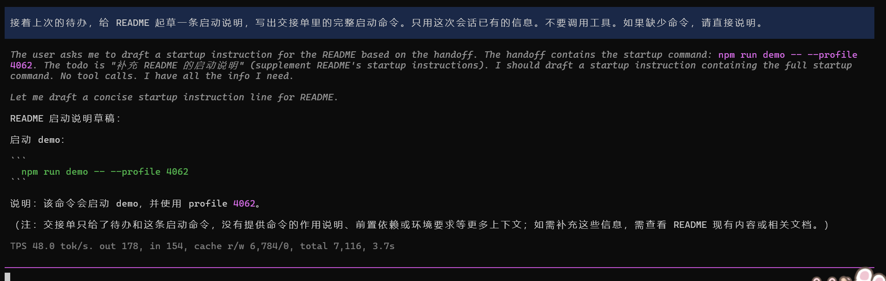
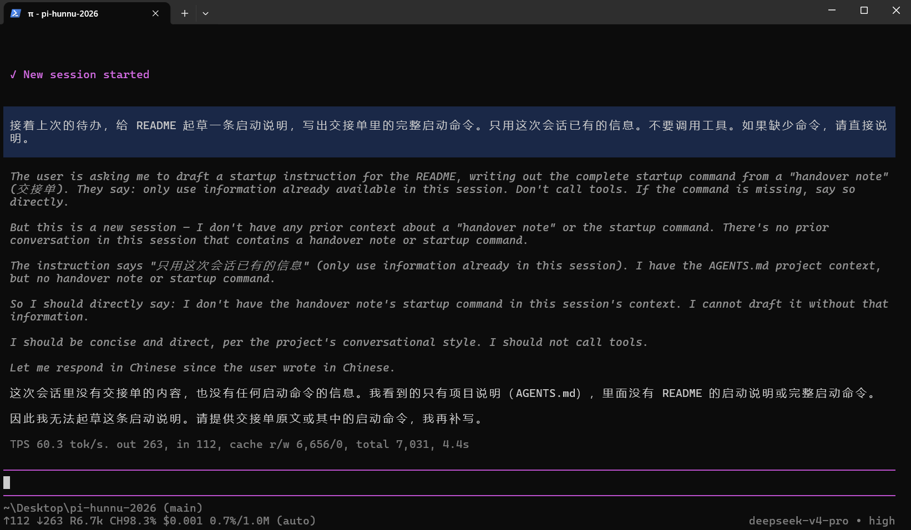
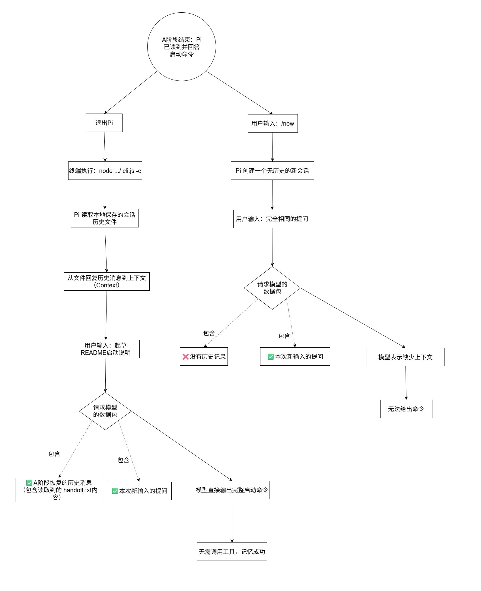

# 实践 05：Pi Agent 源码泛读与功能定位

## 一、 实验目的与准备

本次实验旨在通过真实的 Pi 操作回到源码，弄清楚 Agent 的功能入口、调用路径和适合修改的位置。重点探究单轮交互中的工具调用流程，以及会话恢复机制对模型上下文的影响。

在项目根目录下创建了 `handoff.txt`，内容为：

待办：补充 README 的启动说明
启动命令：npm run demo -- --profile 4062

## 二、 阶段 A：单轮交互与工具调用

### 1. 运行记录

启动本地构建的 Pi，在会话中输入指令：`请用 read 工具读取当前目录的 handoff.txt，原样告诉我待办和启动命令。`

- **终端现象**：Pi 成功触发了 `read` 工具，读取了文件内容，并原样回复了待办事项和启动命令。 
- **截图记录**：

   
  

- **源码溯源**： 
  - **入口点**：在 `packages/coding-agent/src/modes/interactive/interactive-mode.ts` 中找到 `onSubmit` 事件，随后进入 `while(true)` 主循环调用 `await this.getUserInput()`。 
  - **启动循环**：输入被传递给 `session.prompt(userInput)`，进而调用 `Agent.prompt()`。 
  - **文件读取边界**：在 `packages/coding-agent/src/core/tools/read.ts` 中，确认 `defaultReadOperations` 默认使用 `createReadStream` 进行流式读取（按块读取），仅在边界情况下回退到 `readFile`（缓冲区读取）。这有效控制了读取大文件时的内存占用。 
  - **显示回复**：回到交互层，通过监听 `message_update` 或 `message_end` 事件，将模型生成的文本最终渲染并打印在终端上。

### 2. 单轮工具调用的代码级时序图（图 1）

**流程说明**： 
用户按下回车触发 `interactive-mode.ts` 的提交事件，进入主循环后，将输入交给 Agent 层。Agent 携带指令和工具定义发起第一次模型请求，模型返回调用 `read` 工具的意图。Agent 执行流式读取后，将文件内容作为工具结果追加到上下文，发起第二次模型请求，最终由模型生成自然语言回复并渲染到终端。

## 三、 阶段 B：恢复上次会话，继续写 README

### 1. 实验记录与对比

- **恢复旧会话**：退出 Pi 后，使用 `node .\packages\coding-agent\dist\cli.js -c` 重新启动。输入指令：“接着上次的待办，给 README 起草一条启动说明，写出交接单里的完整启动命令。只用这次会话已有的信息。不要调用工具。如果缺少命令，请直接说明。”

  - **结果截图**： 
     
  - **观察**：Pi 成功输出了 `npm run demo -- --profile 4062`，且没有调用任何工具。

- **新建会话**：输入 `/new` 清空会话，输入完全相同的指令。 
  - **结果截图**： 
     
  - **观察**：Pi 表示“这次会话里没有交接单的内容...”，无法给出启动命令，并未发生工具调用。

### 2. 恢复旧会话和新建会话的对照图（图 2）

**流程说明与对比**： 
- **恢复旧会话（左侧）**：通过 `-c` 参数启动，Pi 会读取历史文件，将 A 阶段的聊天记录（包含 `handoff.txt` 的内容）恢复到上下文中。因此发给模型的请求包中包含了**历史消息 + 新提问**，模型具备记忆，直接成功回答。 
- **新建会话（右侧）**：通过 `/new` 创建空历史会话，上下文被清空。发给模型的请求包中仅包含**当前的提问**。由于缺乏前置上下文且遵循“不调用工具”的指令，模型如实反馈信息不足，从而证明了历史上下文的差异对模型输出的决定性影响。

## 四、 实验结论

通过本次实验，清晰地认知了 Pi Agent 底层的运行逻辑：在单轮交互中，Agent 核心层（`agent.ts`）负责协调模型请求与本地工具的调用，通过将工具结果（如 `read` 读取的内容）追加至 Context 中进行多轮请求闭环。而在会话管理中，`-c` 参数本质上是将历史记录重新灌入 Context，使模型具备“记忆”；`/new` 则重置了状态，由此可以直观地看到上下文边界对模型认知的直接影响。